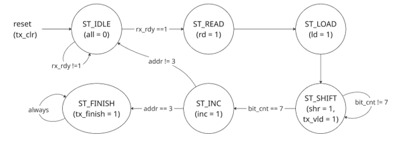
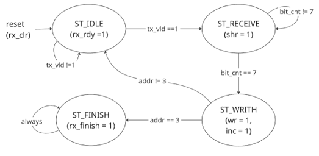
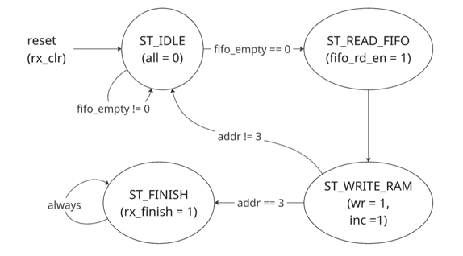
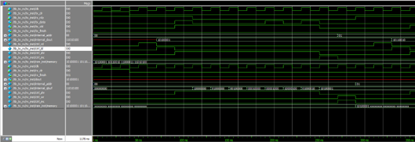
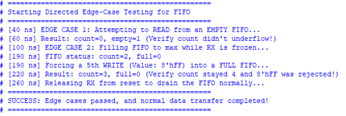

# Synchronous TX/RX Communication System & FIFO Buffer in Verilog

Developed as the final project for the **Advanced Digital Systems Design** course, this repository contains the complete RTL design and functional verification of a synchronous Transmitter-Receiver (TX/RX) communication system in Verilog. 

The project demonstrates the architectural evolution from a serialized bit-by-bit link using a **Valid/Ready (`tx_vld`/`rx_rdy`) handshake protocol** to an optimized, rate-decoupled parallel architecture utilizing a **synchronous FIFO buffer**.

---

## System Evolution & Architecture

### Part 1: Serial TX/RX with Valid/Ready Handshaking
In the baseline architecture, the Transmitter (TX) reads 8-bit words from an internal $4 \times 8$ ROM (`tx_data.txt`), serializes them using a Parallel-In Serial-Out shift register (`TBUF`), and transmits them bit-by-bit over `tx_data`. The Receiver (RX) reconstructs the 8-bit words using a Serial-In Parallel-Out shift register (`RBUF`) and stores them in a $4 \times 8$ RAM.

* **Handshake Protocol (`tx_vld` / `rx_rdy`):** The RX asserts `rx_rdy` in `ST_IDLE` when ready to accept a frame. Upon detecting `rx_rdy == 1`, the TX fetches a word from ROM, loads `TBUF`, and asserts `tx_vld = 1` for exactly 8 clock cycles during `ST_SHIFT` to frame valid serial bits.
* **Single-Cycle Write Optimization:** The RX FSM combines RAM write enable (`wr = 1`) and address increment (`inc = 1`) into a single state (`ST_WRITE`), reducing latency between consecutive frames.

#### Block Diagrams (Part 1)
<p align="center">
  
  
</p>

---

### Part 2: Decoupled TX/RX with Synchronous FIFO Buffer
To eliminate rate bottlenecks between data generation (TX) and data consumption (RX), the second phase replaces the serial shift-register link with a synchronous $4 \times 8$ FIFO buffer (`fifo.v`).

* **Rate Decoupling:** The TX writes full 8-bit words directly into the FIFO whenever `fifo_full == 0`, without waiting for RX readiness. Conversely, the RX pulls words from the FIFO whenever `fifo_empty == 0`.
* **Hardware Simplification:** Using circular read/write pointers (`wr_ptr`, `rd_ptr`) and an internal element counter (`count`) inside the FIFO eliminates shift registers (`TBUF`/`RBUF`) and bit counters, achieving 1-word-per-cycle burst capability.

#### FIFO-Based FSM Diagrams (Part 2)
<p align="center">
  
  
</p>

---

## Functional Verification & Edge-Case Testing

The design was simulated and verified in **ModelSim** using modular unit testbenches and system-level self-checking testbenches:

1. **End-to-End Payload Transfer (`tb_tx_rx.v`):** Verified full transmission and reconstruction of the 4-byte test payload (`8'hA1`, `8'hB2`, `8'hC3`, `8'hD4`) from TX ROM to RX RAM.
2. **Directed FIFO Edge-Case Verification (`tb_tx_rx_edge.v`):**
   * **Underflow Protection:** Held TX in reset while forcing RX read attempts on an empty FIFO (`empty == 1`), confirming that reads were blocked and `count` remained at `0`.
   * **Overflow Protection:** Held RX in reset while TX filled the FIFO to capacity (`count == 4`, `full == 1`), then forced a 5th write (`8'hFF`). Verified that the extra word was rejected without overwriting valid data, followed by clean draining once RX was released from reset.

### Simulation Waveforms & Transcript
<p align="center">
  
</p>
<p align="center">
  
</p>
<p align="center">
  
</p>

---

## Key Engineering Challenges & Solutions

* **Preventing Clock-Edge Race Conditions:** Driving control stimuli on the active rising clock edge (`posedge clk`) initially caused race conditions between testbench stimulus updates and RTL sampling. Driving testbench stimuli on the negative clock edge (`negedge clk`) established a half-cycle setup margin and ensured deterministic sampling.
* **Bit-Alignment Enforcement:** To prevent bit-shift framing errors in the serial receiver, the RX FSM strictly gates shift-register sampling (`shr = 1`) and the 3-bit counter with `tx_vld == 1`, ensuring sampling starts precisely on the LSB of each frame.

---

## Repository Structure

```text
├── diagram/                      # Architectural & FSM diagrams (Part 1 & Part 2)
├── waveforms/                    # ModelSim simulation waveforms & transcript screenshots
├── part1_serial_tx_rx_rtl/       # Part 1 RTL: Serial TX/RX with valid/ready handshake
│   ├── tx_top.v, tx_fsm.v, tx_rom.v, tbuf.v, adrs_reg.v
│   └── rx_top.v, rx_fsm.v, rx_ram.v, rbuf.v, rx_adrs_reg.v
├── part1_serial_tx_rx_tb/        # Part 1 Testbenches & ROM initialization data
│   ├── tb_tx_rx.v, tx_top_tb.v, rx_top_tb.v
│   └── tx_data.txt
├── part2_fifo_tx_rx_rtl/         # Part 2 RTL: Parallel TX/RX with synchronous FIFO
│   ├── fifo.v
│   ├── tx_top.v, tx_fsm.v, tx_rom.v, adrs_reg.v
│   └── rx_top.v, rx_fsm.v, rx_ram.v, rx_adrs_reg.v
└── part2_fifo_tx_rx_tb/          # Part 2 Directed Edge-Case Testbench
    ├── tb_tx_rx_edge.v
    └── tx_data.txt
