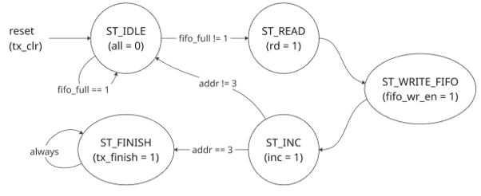
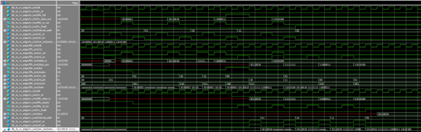

# Synchronous TX/RX Communication System & FIFO Buffer (Verilog)

Final project for the **Digital Systems Design** course. This repository implements and verifies a synchronous Transmitter-Receiver (TX/RX) communication system in Verilog across two architectures:
1. **Part 1 – Serial Link:** Bit-by-bit transmission synchronized via a `tx_vld` / `rx_rdy` handshake protocol.
2. **Part 2 – FIFO-Buffered Link:** Parallel 8-bit data transfer decoupled via a synchronous $4 \times 8$ FIFO buffer.

📄 **[Project Presentation (Hebrew)](Presentation_TX_RX.pptx)**

---

## Architecture

### Part 1: Serial TX/RX
* **TX (`tx_top.v`):** Reads 8-bit words from a $4 \times 8$ ROM (`tx_data.txt`), loads them into a shift register (`tbuf.v`), and transmits serially over `tx_data` when `rx_rdy == 1`.
* **RX (`rx_top.v`):** Samples serial bits into a shift register (`rbuf.v`) while `tx_vld == 1`, and writes the reconstructed 8-bit word into a $4 \times 8$ RAM (`rx_ram.v`) with single-cycle write + address increment (`wr = 1, inc = 1`).

<p align="center">
  
  
</p>

### Part 2: FIFO-Based TX/RX
* **FIFO Buffer (`fifo.v`):** Replaces the serial shift registers with a $4 \times 8$ synchronous buffer managed by circular read/write pointers and an internal element counter.
* **Decoupled Control:** TX writes 8-bit words whenever `fifo_full == 0`; RX reads words whenever `fifo_empty == 0`.

<p align="center">
  
  
</p>

---

## Verification & Simulation (ModelSim)

* **Full Payload Transfer:** Verified end-to-end transmission of `8'hA1`, `8'hB2`, `8'hC3`, `8'hD4` from TX ROM to RX RAM in both architectures.
* **Directed Edge Cases (`tb_tx_rx_edge.v`):**
  * **Underflow Protection:** Blocked RX read attempts when `empty == 1` (`count` remained `0`).
  * **Overflow Protection:** Blocked a 5th write (`8'hFF`) when `full == 1` (`count` remained `4`), preserving existing data.
* **Timing Margin:** Testbench stimuli are driven on `negedge clk` to prevent clock-edge race conditions.

### Waveforms

**Part 1 – Serial Transfer (`TB_TX_RX_A1.png`):**


**Part 2 – FIFO Transfer (`TB_TX_RX_A1 (FIFO).png`):**
.png)

**Part 2 – Overflow & Underflow Edge Cases (`Edge.png` & `Transcript.png`):**



---

## Repository Structure

```text
├── Presentation_TX_RX.pptx       # Project presentation (Hebrew)
├── diagram/                      # Block diagrams (TX, RX, TX_FIFO, RX_FIFO)
├── waveforms/                    # ModelSim simulation waveforms & transcript
├── part1_serial_tx_rx_rtl/       # Part 1 RTL (Serial TX/RX)
├── part1_serial_tx_rx_tb/        # Part 1 Testbenches & tx_data.txt
├── part2_fifo_tx_rx_rtl/         # Part 2 RTL (FIFO-based TX/RX)
└── part2_fifo_tx_rx_tb/          # Part 2 Edge-case Testbench & tx_data.txt
